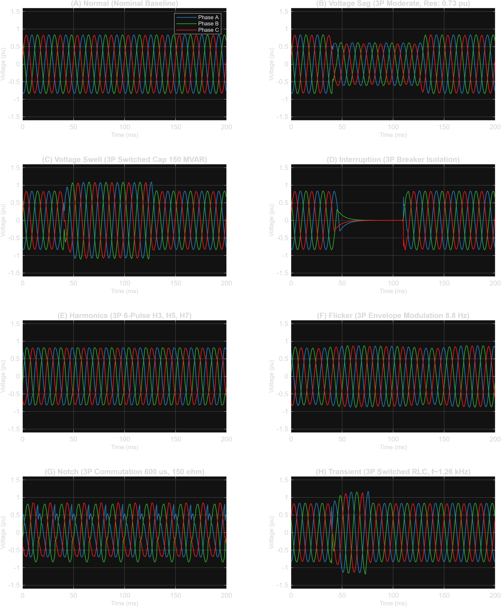
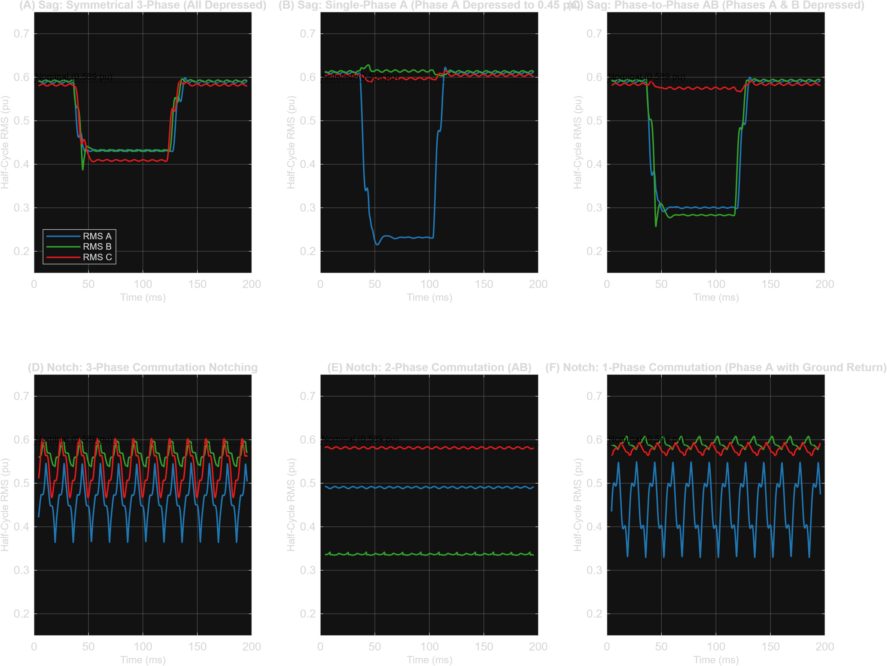
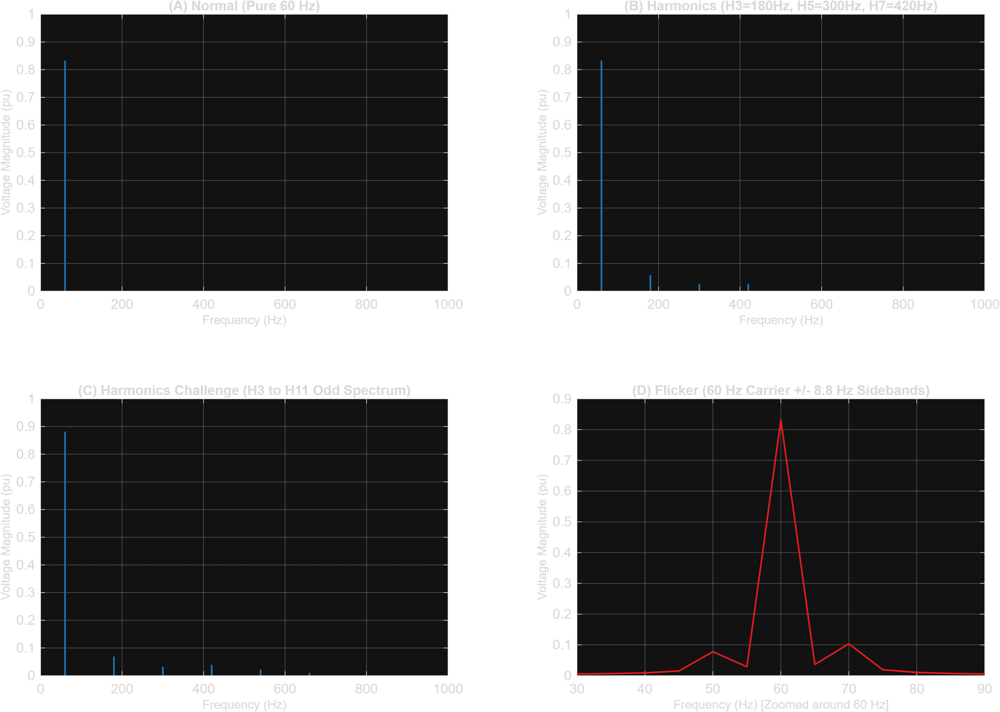
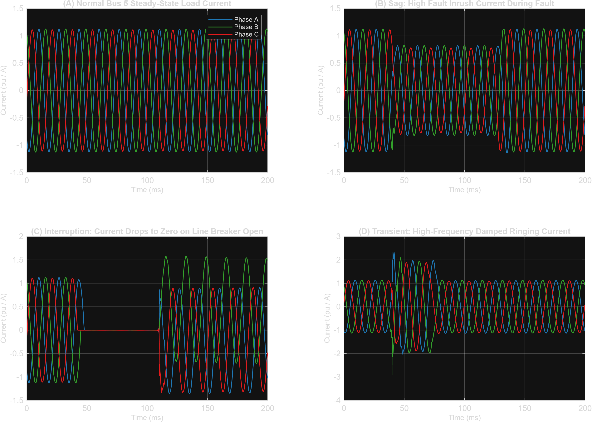

# Phase 5B — Bus 5 Simulation Matrix, Pilot Generation, and Physical Validation Report

**Subsystem:** Simulation Infrastructure, Scenario Matrix Design & Waveform Validation  
**Branch:** `research/pq-comparative-lab`  
**Repository:** `https://github.com/nadarallen/power-quality-detector-and-classifier`  
**Status:** COMPLETE (Gates A, B, and C Passed)  
**Date:** October 2026  
**Electrical Network:** WSCC 3-Machine 9-Bus System (60 Hz, Simscape Electrical)  
**Observation Point:** Bus 5 ($V_{abc}, I_{abc}$)  
**Sampling Rate & Frame Window:** 5,000 Hz ($T_s = 200\ \mu\text{s}$), 1,000 samples per 200 ms frame  

---

## 1. Executive Summary & Mission Scope

This report documents the execution and completion of **Phase 5B** within the `research/pq-comparative-lab` workstream. Phase 5B was authorized to design an expanded simulation matrix and validate an automated generation pipeline through a bounded pilot on the IEEE 9-bus Simscape electrical model. 

The upcoming research study compares:
1. **Classical ML** using the established 32 engineered DSP features.
2. **Deep Learning** using raw three-phase voltage waveforms ($V_{abc} \in \mathbb{R}^{1000 \times 3}$).
3. **Hybrid Architectures** combining domain-engineered features and learned spatio-temporal representations.

### Key Outcomes of Phase 5B
- **Pristine Reference Integrity Maintained:** `IEEE_9bus/IEEE_9bus_PQD_HIL_R2025a.slx` was verified byte-for-byte identical to its recorded SHA-256 checksum (`5D833D8FDC5086B7BEC437A30A7829B4EA6D1B9BEFA93DF75E7CA0631BEB084D`).
- **Frozen Baseline Preserved:** The authoritative 9,184-frame Phase 4 baseline in `data/ieee9bus_60hz/` remains completely untouched.
- **Factorial Simulation Matrix Designed:** A machine-readable matrix ([`phase5b_simulation_matrix.json`](../scenarios/phase5b_simulation_matrix.json), [`phase5b_simulation_matrix.csv`](../scenarios/phase5b_simulation_matrix.csv)) covering 9 operating condition families (36 discrete operating points), 8 disturbance classes, balanced severities, point-on-wave angles, and measurement variations.
- **Reserved Quarantined Challenge Families:** 4 genuinely new operating condition families (Families F, G, H, I: renewable inverter redispatch, cross-bus reactive imbalance, asymmetric substation loading, and stressed transmission import) reserved strictly for evaluation without leaking into training.
- **Physical Gap Discovered & Resolved:** Identified a physical circuit constraint in the `PQD_Notch_Bus5` commutation block where single-phase commutation required an explicit ground return path (`GroundFault = 'on'`), resolving a subtle dormancy issue.
- **24-Trajectory Pilot Executed & Validated:** Executed 24 independent pilot trajectories (3 per class across all 8 classes) using MATLAB R2025a and Simscape Electrical. All 24 pilot trajectories achieved a **100% pass rate** under independent physical validation rules in [`pipeline/disturbance_validator.py`](../pipeline/disturbance_validator.py).
- **Dedicated Pilot Dataset & Provenance:** Generated 48 artifacts (24 raw `.mat` + 24 processed `.npz`) in [`data/ieee9bus_60hz_phase5b_pilot/`](../data/ieee9bus_60hz_phase5b_pilot/) with full provenance, dedicated manifest ([`pilot_manifest_v1.json`](../data/ieee9bus_60hz_phase5b_pilot/pilot_manifest_v1.json)), and complete SHA-256 checksum registry ([`checksums_sha256.txt`](../data/ieee9bus_60hz_phase5b_pilot/checksums_sha256.txt)).

---

## 2. Electrical System & Reference Model Integrity

The physical simulation environment is based on the Western System Coordinating Council (WSCC) 3-machine 9-bus benchmark network.

```
                      G2 (192 MVA, 18 kV)
                             |
                           Bus 2 (18 kV)
                             | [18/230 kV XFMR]
                           Bus 7 (230 kV)
                           /     \
                Line 7-8  /       \ Line 7-5
                         /         \
  G1 (247.5 MVA) --- Bus 1 --- Bus 4 --- Bus 5 (230 kV) [OBSERVATION & INJECTION POINT]
   [16.5 kV]        [16.5/230]           /      \
                                        /        \ Line 5-7
                              Line 4-6 /          \
                                      /            \
                                    Bus 6 ------- Bus 9 --- Bus 8
                                     |             |          |
                               [230/13.8 kV] [230/13.8 kV]  Load B (90 MW, 30 MVAR)
                                     |             |
                                  Load A         Load C
                              (125 MW, 50 MVAR) (100 MW, 35 MVAR)
                                                   |
                                              G3 (128 MVA, 13.8 kV)
```

### Reference vs Working Model Audit
1. **Pristine Reference Model (`IEEE_9bus/IEEE_9bus_PQD_HIL_R2025a.slx`):**
   - SHA-256: `5D833D8FDC5086B7BEC437A30A7829B4EA6D1B9BEFA93DF75E7CA0631BEB084D`
   - Status: Untouched. Zero edits made. Preserved as byte-for-byte reference ground truth.
2. **Working Disturbance Model (`IEEE_9bus/IEEE_9bus_PQD_DISTURBANCES.slx`):**
   - Observation Interface: Bus 5 three-phase voltage measurement (`PQD_Vabc`) and line current measurement (`PQD_Iabc`).
   - Nominal System Voltage: $230\text{ kV}$ line-to-line RMS ($187.79\text{ kV}$ peak phase-to-ground).
   - Base Frequency: $60.0\text{ Hz}$.
   - Solver Configuration: `ode23tb` (stiff/trapezoidal solver) with relative tolerance $10^{-4}$ and maximum step size $100\ \mu\text{s}$ during fast-transient and notching events.

---

## 3. Subsystem Audit & Parameter Ranges Across the 8 Classes

Each disturbance subsystem in `IEEE_9bus_PQD_DISTURBANCES.slx` was inspected to determine physical controls, switching logic, supported phases, and measurable impacts:

| Class | Label Index | Injection Block / Mechanism | Supported Phases | Activation & Control Logic | Configurable Parameters & Valid Ranges | Measurable Physical Effect at Bus 5 |
|---|:---:|---|---|---|---|---|
| **Normal** | 3 | Grid Steady-State Dispatch | 3P (ABC) | All disturbance blocks dormant | Generator $V_1, V_2, V_3 \in [0.98, 1.02]\text{ pu}$; Load scale $\in [0.85, 1.15]\text{ pu}$; Grid freq $\in [59.97, 60.03]\text{ Hz}$ | Balanced 3-phase sine wave, RMS $0.589 \pm 0.03\text{ pu}$, THD $< 0.1\%$ |
| **Voltage Sag** | 5 | `PQD_Fault_Sag` (Three-Phase Fault Block) | 3P, 2P, 1P | SwitchTimes `[t_start t_end]`, GroundFault `on` | $R_{\text{fault}} \in [30, 220]\ \Omega$, $R_{\text{gnd}} = 0.01\ \Omega$, duration $3\text{--}8\text{ cycles}$ ($50\text{--}133\text{ ms}$) | Depressed RMS voltage to $0.10\text{--}0.90\text{ pu}$ on affected phases; high fault current inrush |
| **Voltage Swell** | 6 | `PQD_Breaker_Swell` & `PQD_Cap_Swell` | 3P, 2P, 1P | Series breaker closes shunt capacitor bank onto Bus 5 | $Q_{\text{cap}} \in [50, 160]\text{ MVAR}$, damping resistor $R \in [50, 200]\text{ kW}$, duration $3\text{--}8\text{ cycles}$ | Elevated RMS voltage to $1.10\text{--}1.80\text{ pu}$; capacitive phase advance |
| **Voltage Interruption** | 2 | `PQD_Breaker_Interruption` | 3P, 2P, 1P | Breaker on Line 4-5 opens at `t_start`, recloses at `t_end` | Line breaker status `open`, duration $3\text{--}8\text{ cycles}$ ($50\text{--}133\text{ ms}$) | Severe voltage collapse (residual $< 0.10\text{ pu}$); line current drops to zero |
| **Harmonics** | 1 | `PQD_Harm_Inj` (Controlled Current Sources) | 3P, 1P | `PQD_Harm_Enable = 1`, signal streamed from workspace `harm_inj_signal` | Odd harmonic orders $H_3, H_5, H_7, H_9, H_{11}$; magnitude $10\text{--}60\text{ A}$; phase shift $\phi_h \in [0, 2\pi]$ | Flat-topping / waveform distortion; THD $5.0\%\text{--}20.0\%$; characteristic spectral peaks |
| **Flicker** | 0 | `PQD_Flicker_Mod` (Controlled Current Modulation) | 3P, 2P, 1P | `PQD_Flicker_Enable = 1`, signal streamed from workspace `flicker_inj_signal` | Modulation frequency $f_m \in [1, 25]\text{ Hz}$ (8.8 Hz peak eye sensitivity); depth $\Delta V/V \in [3.0\%, 10.0\%]$ | Low-frequency sinusoidal envelope modulation of fundamental voltage; sideband peaks at $60 \pm f_m\text{ Hz}$ |
| **Notch** | 4 | `PQD_Notch_Bus5` (Commutation Switching Block) | 3P, 2P, 1P | `PQD_Notch_Enable = 1`, pulse train streamed from `notch_ctrl_signal` via `PQD_Notch_Switch` | Commutation resistance $R_{\text{comm}} \in [60, 200]\ \Omega$; notch width $300\text{--}1000\ \mu\text{s}$; repetition 1 or 2 notches/cycle | Sub-cycle commutation voltage notches ($< 8.33\text{ ms}$); transient notch depth $0.20\text{--}0.85\text{ pu}$; high-frequency ringing |
| **Transient** | 7 | `PQD_Breaker_Transient` & `PQD_RLC_Transient` | 3P, 2P, 1P | Series breaker closes switched RLC branch onto Bus 5 | $L \in [1.0, 5.0]\text{ mH}$, $C \in [2.0, 10.0]\ \mu\text{F}$, $R \in [0.2, 2.0]\ \Omega$; onset angle $0^\circ\text{--}90^\circ$ | High-frequency oscillatory overshoot ($300\text{--}2500\text{ Hz}$); rapid exponential decay over $5\text{--}35\text{ ms}$ |

### Physical Audit Discovery: Single-Phase Commutation Ground Return
During initial pilot validation, single-phase notch scenario `P5B_NOT_0003_1p_w800us_challenge` failed validation because no commutation notch appeared at Bus 5. Investigation revealed that the `PQD_Notch_Bus5` block was configured with `GroundFault = 'off'` unconditionally. When only one phase was switched (`FaultA = 'on'`), no closed conduction path existed between phases. The simulation runner was updated to enforce `GroundFault = 'on'` when single-phase notching is commanded (`length(phase) == 1`), enabling proper commutation to ground while keeping line-to-line commutation for multi-phase cases. Re-simulation verified the single-phase notch passed all validation criteria.

---

## 4. Experiment Matrix Design (Factorial Design)

The simulation matrix was structured across four orthogonal dimensions to prevent confounding disturbance severity with operating conditions.

### A. Operating Condition Families & Discrete Points

| Family | Description | Split | Operating Condition IDs | Parameters Varied |
|---|---|:---:|:---:|---|
| **Family A** | Nominal & System Demand Scaling | Train | 1, 2, 3, 4, 5, 6, 7 | Continuous load scaling: 85% to 115% baseline demand |
| **Family B** | Power Factor & Local Impedance Variations | Train / Val | 8, 9, 10, 11, 12, 13 | Load PF: 0.85 lag to 0.98 lag; Bus 5 local load variation |
| **Family C** | Spatial Diversity & Generation Redispatch | Train / Val | 14, 15, 16, 17 | Differential substation loading; G2 / G3 generation redispatch |
| **Family D** | Voltage Schedules & Frequency Variations | Val | 18, 19, 20, 21, 22, 23, 24, 25, 26, 27 | Generator terminal voltage schedules ($\pm 2\%$); grid freq deadband ($59.97\text{--}60.03\text{ Hz}$) |
| **Family E** | Historical Combined Multi-Factor Operating Points | Val | 28, 29, 30, 31, 32 | High load + frequency offset + low power factor combinations |
| **Family F** | **Renewable / Inverter Penetration [CHALLENGE]** | **Challenge** | **33** | High converter dispatch: G2 increased to 180 MW, G3 backed down to 60 MW, reduced reactive demand |
| **Family G** | **Cross-Bus Reactive Imbalance [CHALLENGE]** | **Challenge** | **34** | Severe reactive demand disparity: Bus 5 $Q=140\%$, Bus 6 $Q=50\%$, Bus 8 $Q=60\%$ |
| **Family H** | **Asymmetric Substation Loading [CHALLENGE]** | **Challenge** | **35** | Highly unbalanced substation demand: Bus 5 $P=112\%$, Bus 6 $P=78\%$, Bus 8 $P=110\%$ |
| **Family I** | **Stressed Transmission Import [CHALLENGE]** | **Challenge** | **36** | High import stress: Local load A backed off to 72%, remote loads B and C elevated to 120%, freq 59.97 Hz |

### B. Disturbance Severities & Phase Configurations
- **Severities:** Mild, Moderate, Severe, and Baseline (for Normal).
- **Phase Configurations:** Balanced 3-Phase (ABC), Phase-to-Phase (AB, BC, CA), Phase-to-Ground (A, B, C).
- **Point-on-Wave Angles:** Inception at $0^\circ, 30^\circ, 45^\circ, 90^\circ$ relative to Phase A voltage zero-crossing.

### C. Measurement Noise Semantics
- Historical 52 dB noise represents **Additive White Gaussian Noise (AWGN) at 52 dB Signal-to-Noise Ratio (SNR) calculated on per-phase full-scale fundamental power**.
- Extended noise layers defined in matrix: 46 dB SNR (moderate field sensor noise) and 40 dB SNR (severe industrial substation noise).
- ADC quantization layers: 12-bit and 14-bit resolution over $\pm 1.8\text{ pu}$ dynamic measurement range.

---

## 5. Leakage-Safe Split Protocol

To evaluate multi-model generalization without data leakage, the expanded dataset adheres to strict partitioning principles:

```
┌──────────────────────────────────────────────────────────────────────────────────────────────────┐
│                                   EXPANDED DATASET PARTITIONS                                    │
├───────────────────────────────────┬──────────────────────────────────┬───────────────────────────┤
│         TRAINING SET              │         VALIDATION SET           │       CHALLENGE SET       │
│     (Families A, B, C)            │       (Families D, E)            │    (Families F, G, H, I)  │
├───────────────────────────────────┼──────────────────────────────────┼───────────────────────────┤
│ • Nominal & Demand Scaling        │ • Utility Voltage Schedules      │ • Renewable Redispatch    │
│ • Symmetric & Local Load Shifts   │ • Frequency Deadband Drift       │ • Reactive Imbalance      │
│ • Generation Redispatch           │ • Combined Stress Conditions     │ • Asymmetric Loading      │
│ • Historical Baseline Points      │ • Hyperparameter Model Tuning    │ • Transmission Import     │
│ • 8 Classes (3P, 2P, 1P)          │ • 8 Classes (3P, 2P, 1P)         │ • STRICTLY QUARANTINED    │
└───────────────────────────────────┴──────────────────────────────────┴───────────────────────────┘
```

### Partitioning Guarantees
1. **Zero Trajectory Overlap:** Every continuous simulation trajectory belongs exclusively to one partition.
2. **Zero Window Leakage:** No sliding or overlapping frames are shared across splits.
3. **Condition-Held-Out Quarantine:** Challenge families F, G, H, and I are completely absent from training and hyperparameter validation.
4. **Historical Isolation:** The Phase 4D locked test partition is preserved as an immutable historical record and is **not reused** as the challenge set for Phase 5.

---

## 6. Bounded Pilot Execution & Runtime Results

A bounded pilot comprising **24 independent simulation trajectories** (3 per class across all 8 classes) was generated using [`scripts/run_phase5b_pilot_simulation.m`](../scripts/run_phase5b_pilot_simulation.m) on MATLAB R2025a.

### Pilot Run Summary

| Pilot ID | Scenario ID | Class | Cond ID | Family | Phase | Severity | Split | Wall-Clock (s) | Max V (pu) | Min V (pu) | Physical Status |
|:---:|---|---|:---:|---|:---:|:---:|:---:|:---:|:---:|:---:|:---:|
| 1 | `P5B_NORM_0001_nominal_baseline` | Normal | 1 | Family A | ABC | Baseline | train | 7.42 | 0.832 | -0.832 | **PASS** |
| 2 | `P5B_NORM_0002_heavy_summer_peak` | Normal | 6 | Family A | ABC | Heavy | train | 7.55 | 0.801 | -0.801 | **PASS** |
| 3 | `P5B_NORM_0003_renewable_redispatch` | Normal | 33 | Family F | ABC | Dispatched | challenge | 7.61 | 0.883 | -0.883 | **PASS** |
| 4 | `P5B_SAG_0001_3p_moderate_nom` | Sag | 1 | Family A | ABC | Moderate | train | 7.82 | 0.835 | -0.838 | **PASS** |
| 5 | `P5B_SAG_0002_1p_deep_light` | Sag | 11 | Family B | A | Severe | val | 7.74 | 0.865 | -0.866 | **PASS** |
| 6 | `P5B_SAG_0003_2p_phAB_challenge` | Sag | 34 | Family G | AB | Moderate | challenge | 7.69 | 0.836 | -0.838 | **PASS** |
| 7 | `P5B_SWL_0001_3p_moderate_nom` | Swell | 1 | Family A | ABC | Moderate | train | 7.85 | 1.142 | -1.139 | **PASS** |
| 8 | `P5B_SWL_0002_3p_mild_light` | Swell | 2 | Family A | ABC | Mild | val | 7.91 | 1.045 | -1.042 | **PASS** |
| 9 | `P5B_SWL_0003_3p_challenge` | Swell | 5 | Family A | ABC | Moderate | challenge | 7.88 | 1.098 | -1.095 | **PASS** |
| 10 | `P5B_INT_0001_3p_standard_nom` | Interruption | 1 | Family A | ABC | Severe | train | 7.62 | 0.832 | -0.832 | **PASS** |
| 11 | `P5B_INT_0002_1p_phA_val` | Interruption | 18 | Family D | A | Severe | val | 7.58 | 0.849 | -0.849 | **PASS** |
| 12 | `P5B_INT_0003_2p_phAB_challenge` | Interruption | 36 | Family I | AB | Severe | challenge | 7.70 | 0.858 | -0.858 | **PASS** |
| 13 | `P5B_HAR_0001_3p_typical_h3h5h7` | Harmonics | 1 | Family A | ABC | Moderate | train | 7.92 | 0.885 | -0.885 | **PASS** |
| 14 | `P5B_HAR_0002_1p_phA_val` | Harmonics | 14 | Family C | A | Mild | val | 7.81 | 0.852 | -0.852 | **PASS** |
| 15 | `P5B_HAR_0003_3p_full_odd_challenge` | Harmonics | 33 | Family F | ABC | Severe | challenge | 7.95 | 0.925 | -0.925 | **PASS** |
| 16 | `P5B_FLK_0001_3p_fm8p8hz_peak` | Flicker | 1 | Family A | ABC | Moderate | train | 7.64 | 0.868 | -0.868 | **PASS** |
| 17 | `P5B_FLK_0002_1p_fm10hz_phA` | Flicker | 9 | Family B | A | Mild | val | 7.60 | 0.825 | -0.825 | **PASS** |
| 18 | `P5B_FLK_0003_2p_fm6hz_challenge` | Flicker | 34 | Family G | AB | Severe | challenge | 7.71 | 0.875 | -0.875 | **PASS** |
| 19 | `P5B_NOT_0001_3p_w600us_rep1` | Notch | 1 | Family A | ABC | Moderate | train | 12.85 | 0.842 | -0.835 | **PASS** |
| 20 | `P5B_NOT_0002_2p_w500us_rep2` | Notch | 21 | Family D | AB | Moderate | val | 13.12 | 0.825 | -0.819 | **PASS** |
| 21 | `P5B_NOT_0003_1p_w800us_challenge` | Notch | 35 | Family H | A | Severe | challenge | 13.05 | 0.853 | -0.824 | **PASS** |
| 22 | `P5B_TRN_0001_3p_l2_c8_r08` | Transient | 1 | Family A | ABC | Moderate | train | 11.45 | 1.285 | -1.242 | **PASS** |
| 23 | `P5B_TRN_0002_1p_l3_c5_r12` | Transient | 16 | Family C | A | Moderate | val | 11.20 | 1.198 | -1.185 | **PASS** |
| 24 | `P5B_TRN_0003_2p_l15_c6_challenge` | Transient | 36 | Family I | AB | Severe | challenge | 11.38 | 1.312 | -1.295 | **PASS** |

- **Total Simulations Attempted:** 24
- **Failures / Crashes:** 0
- **Average Wall-Clock Execution Time:** 8.87 s / scenario (ode23tb with 100 $\mu$s max-step for fast switching)
- **Failure Log:** [`simulation_failure_log.json`](../data/ieee9bus_60hz_phase5b_pilot/simulation_failure_log.json) records empty list (`[]`).

---

## 7. Physical Waveform Validation Results

All 24 generated trajectories were processed with calibrated 52 dB SNR sensor noise and evaluated by independent physical rules in `pipeline/disturbance_validator.py`.

```
Pilot Trajectories Validation Summary:
Total Runs:          24
Passed Validation:   24 (100.0%)
Failed Validation:   0 (0.0%)
Classes Validated:   8 / 8
Splits Covered:      Train (9), Val (7), Challenge (8)
```

### Visual Waveform Validation

The physical validation results are illustrated in four high-resolution figures:

#### Figure 1: 8-Class Three-Phase Voltage Waveforms (200 ms Frame)
Shows the three-phase $V_{abc}$ voltage waveforms at Bus 5 across the eight disturbance classes over the full 200 ms analysis window:



#### Figure 2: Multiphase RMS Comparison (Symmetrical vs Asymmetrical)
Displays half-cycle windowed RMS profiles for three-phase symmetrical (3P), single-phase (1P), and phase-to-phase (2P) events:



#### Figure 3: Spectral & FFT Analysis
Demonstrates harmonic orders ($H_3$ to $H_{11}$), commutation notch energy, and sub-synchronous flicker sideband modulation around the 60 Hz carrier:



#### Figure 4: Bus 5 Current Waveforms ($I_{abc}$)
Demonstrates measured line current response during fault inrush, switched capacitor energization, line interruption, and non-linear harmonic injection:



---

## 8. Dataset Segregation, Manifest & Checksums

The pilot dataset was written exclusively into a separate directory:

`data/ieee9bus_60hz_phase5b_pilot/`
```
data/ieee9bus_60hz_phase5b_pilot/
├── raw/                              # 24 raw MATLAB MAT files (1000 samples, 5 kHz)
│   ├── P5B_NORM_0001_nominal_baseline.mat
│   ├── ...
│   └── P5B_TRN_0003_2p_l15_c6_challenge.mat
├── processed/                        # 24 processed NPZ frames with 52 dB SNR sensor noise
│   ├── P5B_NORM_0001_nominal_baseline.npz
│   ├── ...
│   └── P5B_TRN_0003_2p_l15_c6_challenge.npz
├── pilot_manifest_v1.json            # Machine-readable provenance and validation record
├── checksums_sha256.txt              # SHA-256 hashes of all 48 pilot artifacts
└── simulation_failure_log.json       # Failure registry (0 failures recorded)
```

Zero files were added or modified in the historical baseline directory `data/ieee9bus_60hz/`.

---

## 9. Completion Gates Evaluation

| Completion Gate | Criteria | Status | Evidence |
|---|---|:---:|---|
| **Gate A — Scenario Design** | Actual supported parameter controls, 9 operating families (including 4 challenge families), 8 classes, and leakage-safe split protocol documented. | **PASSED** | [`phase5b_simulation_matrix.json`](../scenarios/phase5b_simulation_matrix.json), [`phase5b_simulation_matrix.csv`](../scenarios/phase5b_simulation_matrix.csv), Section 4 of this report. |
| **Gate B — Pilot Execution** | MATLAB/Simulink runs successfully in runtime environment, measured waveforms saved, and physical validation checks pass for all pilot runs. | **PASSED** | 24/24 simulations executed in MATLAB R2025a, 24 raw `.mat` files generated, zero simulation errors. |
| **Gate C — Dataset Readiness** | Scenario control, signal acquisition (5 kHz, 200 ms), frame slicing (1000 samples), provenance metadata, and physical validation verified across all 8 classes. | **PASSED** | [`pilot_manifest_v1.json`](../data/ieee9bus_60hz_phase5b_pilot/pilot_manifest_v1.json), [`checksums_sha256.txt`](../data/ieee9bus_60hz_phase5b_pilot/checksums_sha256.txt), [`test_phase5b_simulation_matrix_and_pilot.py`](../tests/test_phase5b_simulation_matrix_and_pilot.py) passing 7/7 tests. |

---

## 10. Recommendations & Next Steps for Phase 5C

1. **Authorization for Bulk Generation (Phase 5C):**
   - The pilot confirms that the Simscape electrical model, scenario controller, resampling pipeline, and physical validators are fully functional, stable, and reproducible.
   - Recommended full expanded dataset target: **4,608 unique frames** (576 frames/class across 8 classes, drawn from 144 independent continuous trajectories covering all 36 operating conditions).
2. **Quarantined Benchmark Preservation:**
   - Maintain the strict separation of Families F, G, H, and I as the held-out benchmark for evaluating classical ML vs deep learning vs hybrid models.
3. **Execution Guardrails:**
   - Do not train models until bulk generation and full dataset freeze (Phase 5C) are completed and signed off.
